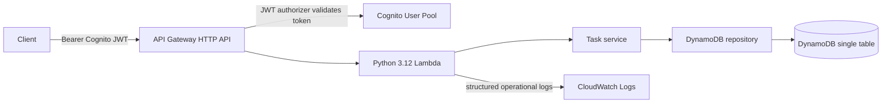

# Architecture

## Request and data flow

API Gateway's native JWT authorizer validates the Cognito issuer, token signature, expiry and audience before invoking Lambda, and enforces the `tasks/read` OAuth scope on GET routes and `tasks/write` on mutations. The Cognito resource server defines the custom scopes and the public app client enables the authorization-code flow with those scopes. The handler separately reads `sub` from the validated authorizer claims. It does not accept an owner identifier in request bodies or query parameters. Repository key construction scopes every read, query, update and delete to `USER#{sub}`. Route scopes control allowed operations; they do not replace object-level ownership checks.

The DynamoDB table uses `PK=USER#{sub}` and `SK=TASK#{uuid}`. A user list is a partition-key query; pagination uses DynamoDB's last evaluated key encoded as a URL-safe cursor. The cursor is structurally checked and remains scoped by the partition key in all actual queries. Items contain a task ID, mutable task fields and UTC timestamps.

The application separates HTTP routing/response formatting (`handlers/http.py`), use cases (`service.py`), request validation (`validation.py`) and persistence (`repository.py`). DynamoDB uses on-demand billing, server-side encryption and point-in-time recovery. Terraform enables deletion protection. Lambda IAM grants only the table operations used by the application and write access to its pre-created log group.

## Availability and operational notes

API Gateway and Lambda are managed regional services. DynamoDB is regional. This first version uses synchronous CRUD operations, no VPC attachment, no external network calls and no cross-region replication. It does not implement task-level idempotency, optimistic concurrency, soft deletion, search/filter indexes, audit history, attachment upload, custom domains, WAF, or automated backups outside DynamoDB PITR.

CloudWatch logging omits JWTs and request bodies. Application logs carry the API Gateway request ID on unexpected errors. API access logs are limited to request ID, route, status and source IP; review privacy and retention requirements before production use. Rate limits are starter defaults, not a capacity guarantee. CORS currently has a deliberately narrow placeholder origin that must be set to the actual frontend origin before use.

## Security boundaries

- Authentication is performed by API Gateway; client-supplied identity fields are rejected by strict schema validation.
- User-owned keys are generated server-side from signed JWT `sub` claims.
- Missing or foreign task IDs produce the same 404 response to avoid disclosing another user's records.
- IAM actions are table-scoped. No scans, batch export, or cross-table access is granted.
- Cognito client has no client secret for public-client use, prevents user-existence disclosure, and enables token revocation.
- DynamoDB encryption and PITR are enabled. TLS is used by the managed service interfaces.
- API and Lambda logs use finite retention; review data retention and PII policy before production.
